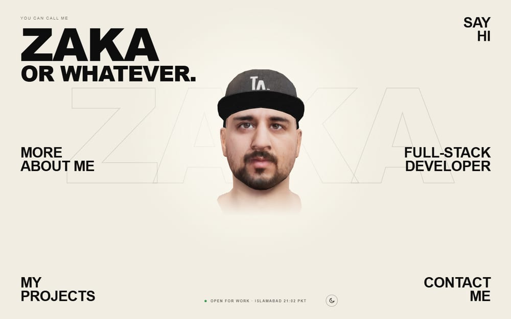
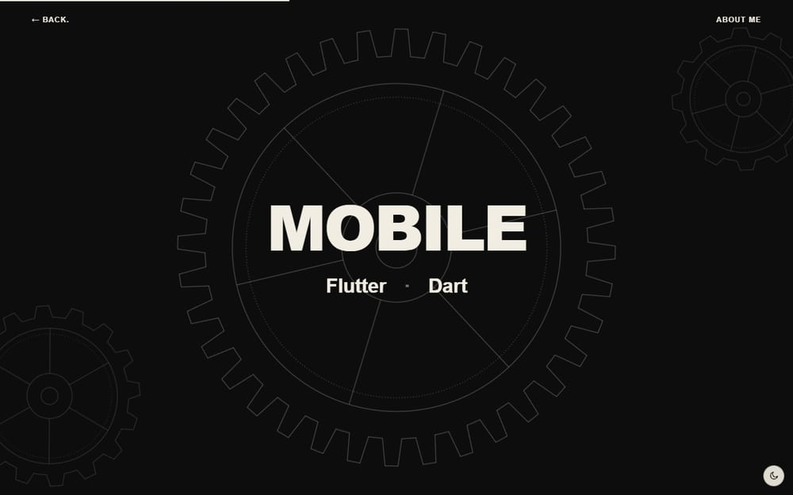
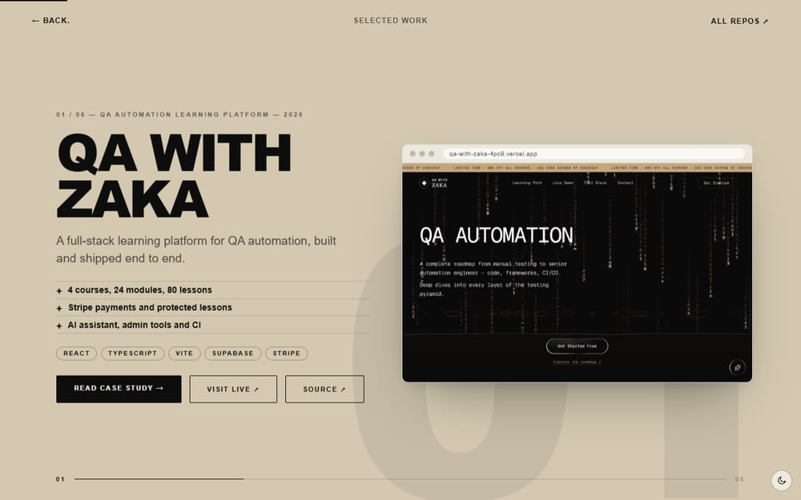
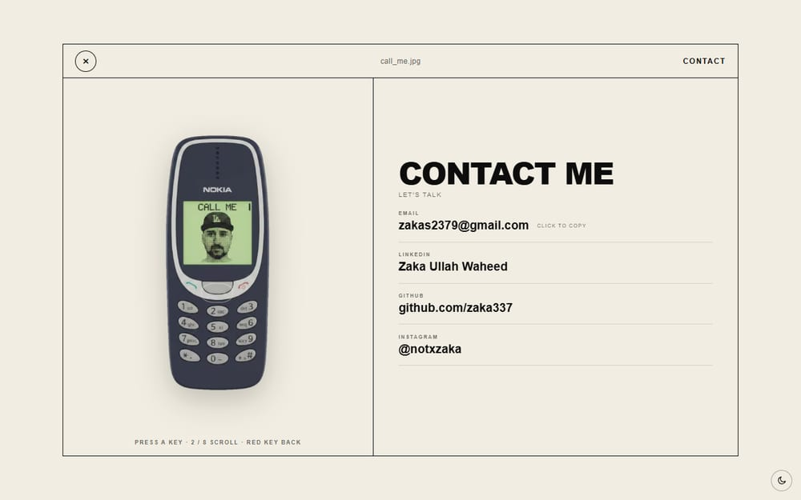

# Zaka Ullah Waheed — Portfolio

A 3D, scroll-driven developer portfolio built with Next.js, React and three.js.

**Live:** https://zaka-portfolio-two.vercel.app

<p align="center">
  
  
  
  
</p>

## What's in it

- **3D home.** A rigged avatar (React Three Fiber) that follows the cursor, breathes, and nods when you click it. Visitors without WebGL, or who prefer reduced motion, get a still photo instead.
- **Scroll-story About and Projects pages.** Pinned chapters driven by one progress value per chapter, with eased motion that feels the same on 60 Hz and 120 Hz screens.
- **Case studies.** One statically generated page per featured project, all from a single data file (`lib/projects.ts`).
- **All repos in 3D.** A carousel of every public GitHub repo at `/projects/all`. The list comes from a cached server route (`/api/repos`) and falls back to a saved copy, then to the featured projects, so the page is never empty when GitHub is rate-limited.
- **Contact.** A working Nokia 3310 at `/contact` (it even has Snake), and a project-brief form at `/contact-me` that emails through Resend. If sending is not possible it opens the visitor's mail app with the brief ready to send.
- **Resume.** `/resume` prints to a single A4 page, and the PDF is downloadable.
- **Light and dark themes.** Light by default for everyone; dark is opt-in through the toggle and remembered per device.
- **The details.** Branded 404, sitemap, robots, JSON-LD, Open Graph image, per-page metadata, and cookie-free analytics (Vercel Web Analytics).

## Tech

Next.js 16 (App Router, Turbopack) · React 19 · TypeScript · three.js, React Three Fiber and drei · hand-written CSS on design tokens (no UI framework) · Resend for email · deployed on Vercel.

## Getting started

Requires Node.js 20.9 or newer.

```bash
git clone https://github.com/zaka337/zaka-portfolio.git
cd zaka-portfolio
npm install
npm run dev        # http://localhost:3000
```

`npm install` works without flags because `.npmrc` sets `legacy-peer-deps`.

| Script | What it does |
| --- | --- |
| `npm run dev` | Development server |
| `npm run build` | Production build |
| `npm start` | Serve the production build |
| `npm run bake:env` | Re-bake the avatar's lighting map (see below) |

### Environment variables

Copy `.env.example` to `.env.local`. Everything is optional; the site runs without any of them.

| Variable | Purpose |
| --- | --- |
| `RESEND_API_KEY` | Delivers the contact form by email. Without it the form falls back to the visitor's mail app. |
| `CONTACT_TO` | Where messages go (defaults to zakas2379@gmail.com). |
| `CONTACT_FROM` | Sender address. The default only delivers to the Resend account owner; use a verified domain otherwise. |
| `GITHUB_TOKEN` | Raises GitHub's API limit from 60 to 5,000 requests per hour for `/api/repos`. A token with no scopes is enough. |
| `NEXT_PUBLIC_SITE_URL` | Overrides the site URL used for canonical links, the sitemap and Open Graph tags. |

## Project structure

```
app/                  Routes: about, projects (featured, all, [slug]), contact, contact-me,
                      resume, api/contact, api/repos, 404, sitemap, robots, manifest
components/           AvatarScene (3D), NokiaPhone and NokiaSnake, CustomCursor,
                      ThemeToggle, Reveal, ...
lib/                  projects.ts (case-study content), resume.ts, site.ts (links and URLs),
                      scrollStory.ts (scroll engine), bakedEnv.ts, snakeGame.ts, ...
public/               Avatar.glb, face-still.webp, env/ (baked lighting), project screenshots,
                      resume PDF
scripts/bake-env.mjs  Pre-bakes the avatar's lighting map
docs/screenshots/     Images used in this README
```

Content lives in a few files: projects in `lib/projects.ts`, the resume in `lib/resume.ts`, links and contact details in `lib/site.ts`.

## Performance notes

The site is tuned to hold a steady frame rate, including on high-refresh screens.

- Scroll progress is written only on the elements that use it. CSS custom properties inherit, so writing one on a page-level ancestor re-styles every element on every frame.
- All easing is time-based, never per-frame, so animation speed does not change with the refresh rate.
- The avatar drops the meshes that are never visible, compiles its shaders in parallel, renders into a centred canvas rather than the full viewport, and adapts its pixel ratio to the device.
- The avatar's studio lighting map is pre-baked into `public/env/` so visitors do not compile an expensive shader on first load.

**After upgrading `three`:** run `npm run bake:env` and commit the new file in `public/env/`. The file name carries the three.js revision; if it does not match, the site still works but builds the map in the browser, which is slower on a first visit.

## Deploying

Import the repository into Vercel, add any environment variables above, and deploy. No other configuration is needed.

## Credits

The avatar was created with [Avaturn](https://avaturn.me).

## Contact

[zakas2379@gmail.com](mailto:zakas2379@gmail.com) · [LinkedIn](https://www.linkedin.com/in/zaka-ullah-waheed-80380832a) · [GitHub](https://github.com/zaka337) · [Instagram](https://www.instagram.com/notxzaka/)
